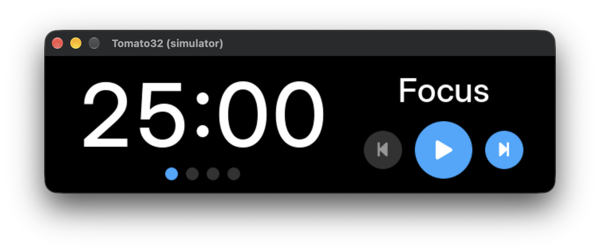
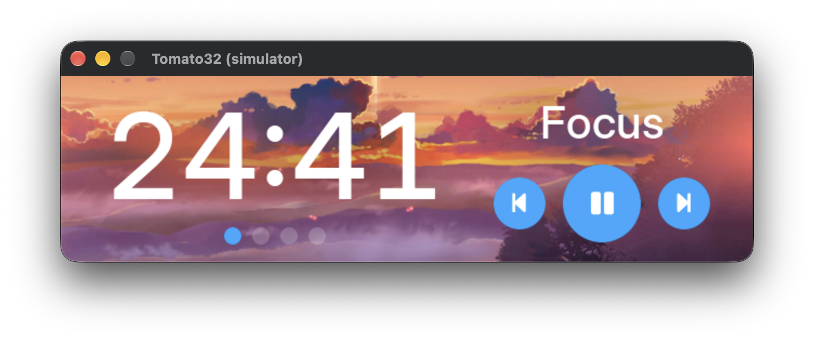
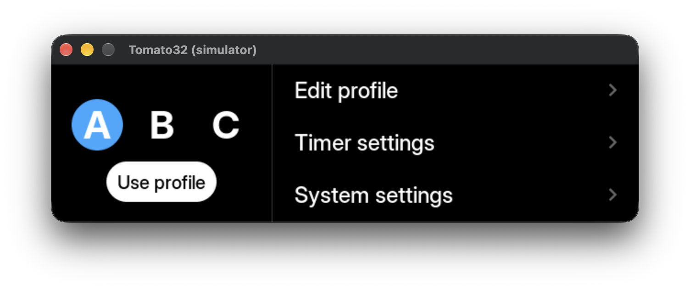
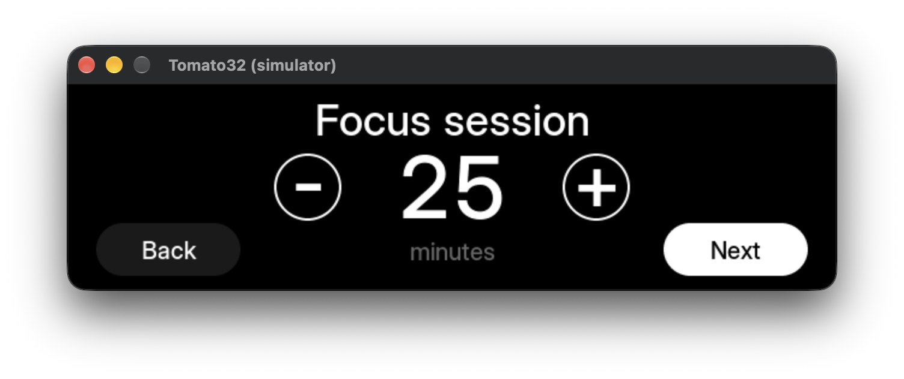
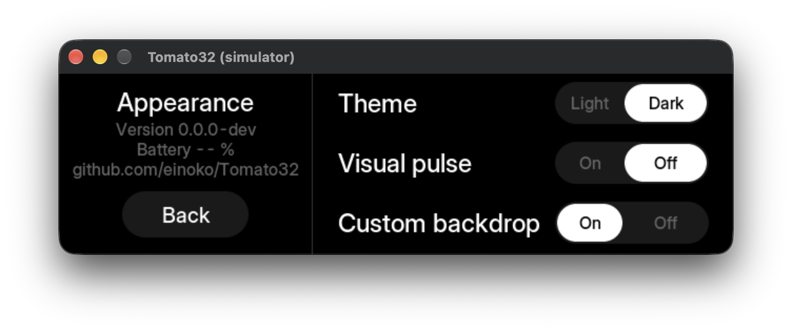

# Tomato32


Tomato32 is a [Pomodoro](https://en.wikipedia.org/wiki/Pomodoro_Technique) timer for the [Waveshare ESP32-S3-Touch-LCD-3.49](https://www.waveshare.com/esp32-s3-touch-lcd-3.49.htm) development board.

## Video

https://github.com/user-attachments/assets/c5f4a6f5-b433-481a-8e97-07911eff9add

## Features

- Touchscreen UI
- Three adjustable timer profiles
- Highly customizable (see [Settings](#settings))
- Approximately 14–24 hours of battery life, depending on display brightness

## Installation

### Browser installer

The easiest way to install and update Tomato32 is to use the [Tomato32 Web Installer](https://einoko.github.io/Tomato32/).

> [!NOTE]
> Chrome or Edge required.

### Building and flashing manually

```sh
cd platform/esp32
python -m venv .venv
source .venv/bin/activate
pip install -r requirements.txt
./build.sh clean
./build.sh flash /dev/cu.usbmodem101
```

> [!NOTE]
> Before flashing, verify the correct serial port with `ls /dev/cu.*`.

### Running in a simulator

#### macOS

```bash
# Install dependencies
brew install cmake sdl2

# Build and launch the simulator
cmake -B build
cmake --build build
./build/platform/simulator/pomodoro_sim
```

#### Linux

```bash
# Install dependencies
sudo apt install cmake libsdl2-dev

# Build and launch the simulator
cmake -B build
cmake --build build
./build/platform/simulator/pomodoro_sim
```

## Boot modes

There are two boot modes:

1. **Normal boot:** Hold the **PWR** button until you see the splash screen.
2. **Config mode:** Hold the **PWR** button. After about a second, also press and hold the **BOOT** button. Keep holding both buttons until you see a config mode splash screen.

### Config mode

Config mode lets you enter Wi-Fi credentials to automatically sync the device time using NTP. It's a completely optional step, and it's only useful if you're interested in accurate daily usage statistics.

#### Entering Wi-Fi credentials

Boot in config mode. Connect the device to your computer using a USB-C cable. A drive will appear on your computer. On the drive you will see a `TOMATO32_CONFIG.conf` file. Open `TOMATO32_CONFIG.conf` and enter your Wi-Fi credentials and time zone information.

```
WIFI_SSID_1=your_network
WIFI_PASS_1=your_password
WIFI_SSID_2=another_network
WIFI_PASS_2=another_password
TZ=UTC0
```

You can configure up to 8 Wi-Fi networks. `TZ` accepts a [POSIX TZ string](https://developer.ibm.com/articles/au-aix-posix/). After editing, save the file, eject the drive and restart the device.

## Settings

Press **BOOT** to open Settings. Press it again to go back to the timer.

### Profiles

Pick one of the three profiles (A, B, C) on the left. Tap **Use profile** to switch to it, or **Edit profile** to change it.

| Setting       | Range    | Description                                   |
| ------------- | -------- | --------------------------------------------- |
| Focus session | 1–99 min | Length of a focus session.                    |
| Short break   | 1–99 min | Length of a short break.                      |
| Long break    | 1–99 min | Length of a long break.                       |
| Rounds        | 2–10     | Number of focus sessions before a long break. |

### Timer settings

| Setting         | Options       | Description                                                                                                                       |
| --------------- | ------------- | --------------------------------------------------------------------------------------------------------------------------------- |
| Advance to next | Auto / Manual | Auto starts the next phase immediately after the current one finishes. In Manual mode, you need to start the next phase yourself. |
| Remember timer  | On / Off      | Persists the timer state (current phase, round, remaining time) across restarts.                                                  |

### System settings

#### Display

##### Appearance

| Setting         | Options      | Description                                                                                |
| --------------- | ------------ | ------------------------------------------------------------------------------------------ |
| Theme           | Light / Dark | Color theme.                                                                               |
| Visual pulse    | On / Off     | Pulsing background color when the timer ends.                                              |
| Custom backdrop | On / Off     | Displays a custom background on the timer (see [Custom Backgrounds](#custom-backgrounds)). |

##### Brightness

| Setting     | Options  | Description                     |
| ----------- | -------- | ------------------------------- |
| Smart dim   | On / Off | Dims the screen while idle.     |
| Smart sleep | On / Off | Turns the screen off when idle. |

**Edit brightness settings** opens these values:

| Setting              | Range    | Description                             |
| -------------------- | -------- | --------------------------------------- |
| Default brightness   | 10–100%  | Normal screen brightness.               |
| Smart dim brightness | 10–100%  | Brightness while dimmed.                |
| Smart dim delay      | 1–99 min | Idle time before the screen dims.       |
| Smart sleep delay    | 1–99 min | Idle time before the screen turns off.  |
| Visual pulse opacity | 10–100%  | Opacity of the visual pulse background. |

##### Battery indicators

| Setting     | Options  | Description                                 |
| ----------- | -------- | ------------------------------------------- |
| Low charge  | On / Off | Red indicator at 20% battery or lower.      |
| Full charge | On / Off | Green indicator when the battery is full.   |
| Always show | On / Off | Keeps the battery indicator always visible. |

#### Sound

| Setting    | Options  | Description                            |
| ---------- | -------- | -------------------------------------- |
| Sound      | On / Off | Plays a chime when a phase ends.       |
| Volume     | 10–100%  | Chime volume.                          |
| Test sound | Play     | Plays the chime at the current volume. |

#### General

##### Date & time

| Setting     | Options      | Description                                                                                                                   |
| ----------- | ------------ | ----------------------------------------------------------------------------------------------------------------------------- |
| Date source | NTP / Manual | Syncs the time over Wi-Fi (NTP). NTP needs Wi-Fi credentials (see [Entering Wi-Fi credentials](#entering-wi-fi-credentials)). |
| Set date    |              | Only available when Date source is Manual.                                                                                    |
| Set time    |              | Only available when Date source is Manual.                                                                                    |

## Special screens

### Statistics screen

Shows **Focused today** and all-time **Total focus time**.

To open the statistics screen, tap and hold the phase label (Focus / Break / Long Break) on the main timer screen for 1 second.

### Debug screen

Shows debugging information.

To open the debug screen, tap the main timer text (MM:SS) 10 times within 5 seconds.

## Custom backgrounds

To use a custom background image on the timer, go to **System Settings → Display → Appearance** and set **Custom backdrop** to **On**.

Place your image files (640×172 PNG) in the `app/` directory, then rebuild and flash.

### Custom background file naming

Tomato32 uses the most specific matching file available. Name your files accordingly:

| Specificity     | File name example              | When it's used            |
| --------------- | ------------------------------ | ------------------------- |
| Profile + theme | `custom_background_b_dark.png` | Profile B, dark mode only |
| Profile only    | `custom_background_b.png`      | Profile B, both themes    |
| Theme only      | `custom_background_dark.png`   | Any profile, dark mode    |
| _(fallback)_    |                                | Default solid color       |

Valid profile suffixes are `_a`, `_b`, and `_c`. Valid theme suffixes are `_dark` and `_light`.

> [!IMPORTANT]
> Background images are embedded into the firmware at build time. Whenever you add or remove PNG files in `app/`, run a clean build so CMake picks up the changes:
>
> ```sh
> cd platform/esp32
> ./build.sh clean
> ./build.sh flash /dev/cu.usbmodem101
> ```

## Third-party licenses

This project vendors LVGL under `lvgl/`.

- Project-level notices: `THIRD_PARTY_NOTICES.md`
- LVGL license: `lvgl/LICENCE.txt`
- LVGL third-party attributions: `lvgl/COPYRIGHTS.md`

### Typeface

The typeface used in the UI is [Inter](https://rsms.me/inter/), licensed under the SIL Open Font License 1.1.

### Sound effect

The sound effect played when a timer phase ends is sourced from [freesound.org](https://freesound.org/people/JetRye/sounds/140128) and licensed under Creative Commons 0.

### Custom background images

#### Dark mode

- Photo by [Federico Respini](https://unsplash.com/@federicorespini) on [Unsplash](https://unsplash.com/photos/brown-field-near-tree-during-daytime-sYffw0LNr7s).

#### Light mode

- Photo by [Alex Machado](https://unsplash.com/@alexmachado) on [Unsplash](https://unsplash.com/photos/cloudy-sky-80sv993lUKI).

## Screenshots










